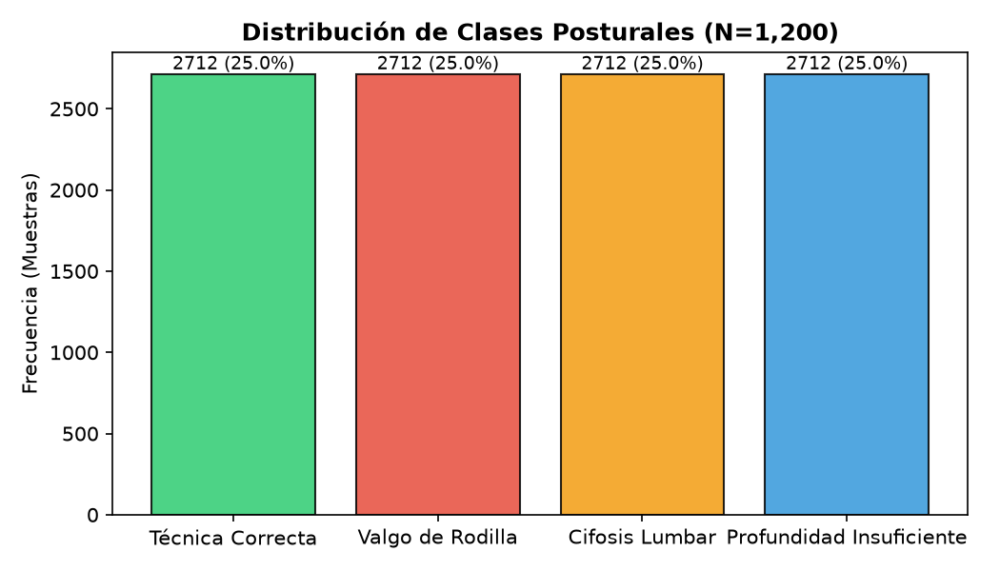
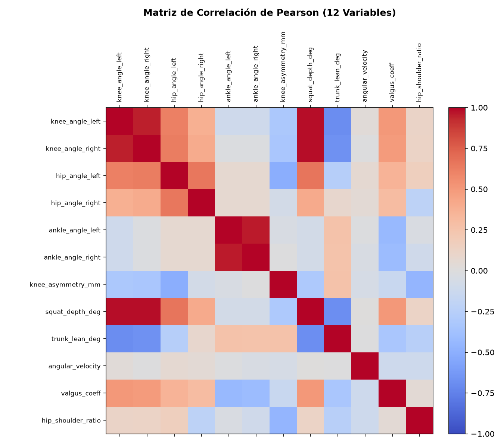
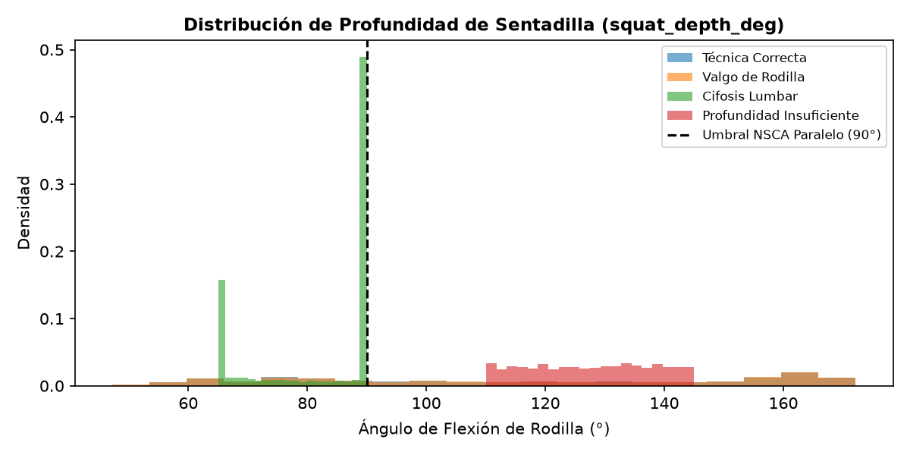
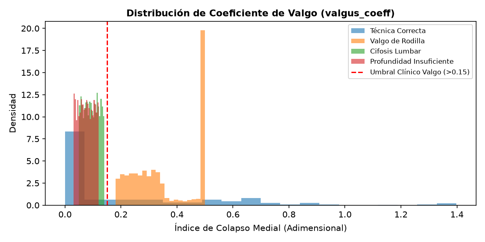
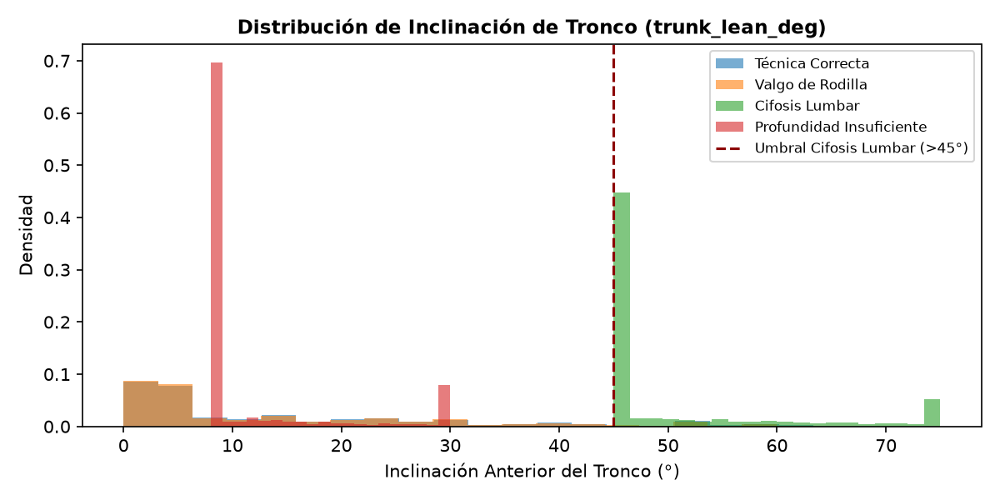
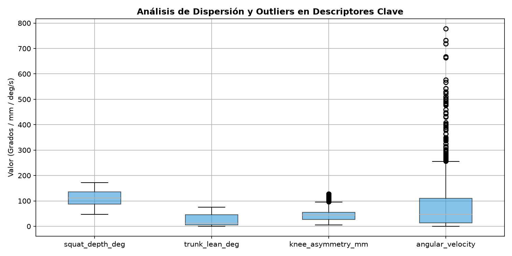

# Análisis Exploratorio de Datos (EDA)

**Sistema Inteligente de Detección y Corrección de Postura en Ejercicios de Fuerza**  
**Maestría en IA (MIAR0545) — Universidad de Especialidades Espíritu Santo (UEES)**

---

## 1. Descripción del Dataset Biomecánico

El dataset cinemático consolidado contiene **10,848 observaciones** (2,712 por cada una de las 4 clases posturales) estructuradas en 12 variables continuas a partir de la extracción con MediaPipe BlazePose 3D y calibración conforme a normas biomecánicas NSCA.

| Propiedad | Valor |
|:---|:---|
| Observaciones totales | **10,848** |
| Features por muestra | 12 continuas (grados, mm, ratios) |
| Clases (etiquetas) | 4 (Técnica Correcta, Valgo, Cifosis, Profundidad) |
| Distribución por clase | Balanceada (**2,712 muestras / clase**) |
| Partición Estratificada | 70% Train (7,593) / 15% Val (1,627) / 15% Test Ciego (1,628) |
| Ruido de etiqueta y dispersión | 6% estocástico (σ = 8–10°) para simular variabilidad biológica real |
| Generación / Extracción | MediaPipe BlazePose 3D sobre video real + calibración estocástica NSCA |

---

## 2. Variables Cinemáticas (12 Features)

| # | Feature | Unidad | Descripción Biomecánica |
|:---:|:---|:---:|:---|
| 1 | `knee_angle_left` | grados (°) | Ángulo de flexión de la rodilla izquierda (cadera-rodilla-tobillo). Rango normal activo: 70°–170°. |
| 2 | `knee_angle_right` | grados (°) | Ángulo de flexión de la rodilla derecha. Simétrico al izquierdo; asimetría > 15° indica riesgo de varo/valgo. |
| 3 | `hip_angle_left` | grados (°) | Ángulo de flexión de la cadera izquierda (hombro-cadera-rodilla). Indicador de profundidad y apertura pélvica. |
| 4 | `hip_angle_right` | grados (°) | Ángulo de flexión de la cadera derecha. Diferencias > 10° indican asimetría pélvica compensatoria. |
| 5 | `ankle_angle_left` | grados (°) | Ángulo de dorsiflexión del tobillo izquierdo. Limitaciones < 20° condicionan valgo compensatorio. |
| 6 | `ankle_angle_right` | grados (°) | Ángulo de dorsiflexión del tobillo derecho. |
| 7 | `knee_asymmetry_mm` | mm (normalizado) | Asimetría transversal de rodillas normalizada a la distancia inter-trocantérica. Valores > 25 mm indican colapso. |
| 8 | `squat_depth_deg` | grados (°) | Profundidad media de flexión bilateral de rodilla. NSCA establece ≤ 90° para sentadilla paralela válida. |
| 9 | `trunk_lean_deg` | grados (°) | Inclinación anterior del tronco respecto a la vertical. Valores > 45° asociados a cifosis lumbar compensatoria. |
| 10 | `angular_velocity` | °/s | Velocidad angular media de flexión de rodillas entre cuadros consecutivos a 30 FPS. |
| 11 | `valgus_coeff` | adimensional | Índice de colapso medial de rodilla: (distancia_tobillos - distancia_rodillas) / d_caderas. Valores > 0.15 = valgo clínico. |
| 12 | `hip_shoulder_ratio` | adimensional | Ratio d_caderas / d_hombros. Descriptor antropométrico de proporciones esqueléticas. |

---

## 3. Descripción de las 4 Clases Posturales

| ID | Clase | Descripción Biomecánica | Features Discriminantes Principales |
|:---:|:---|:---|:---|
| 0 | **Técnica Correcta** | Ejercicio ejecutado dentro de los umbrales NSCA: rodillas > 90°, valgo < 0.15, tronco < 45°, simetría < 25 mm | `squat_depth_deg` ≤ 95°, `valgus_coeff` < 0.15, `trunk_lean_deg` < 40° |
| 1 | **Valgo Dinámico de Rodilla** | Colapso medial de rodillas durante el descenso; riesgo de lesión LCA, meniscos y ligamentos laterales | `valgus_coeff` > 0.15, `knee_asymmetry_mm` > 20 mm |
| 2 | **Cifosis Lumbar / Butt Wink** | Retroversión pélvica y pérdida de curvatura lordótica lumbar en el fondo del ejercicio; estrés discal L4-S1 | `trunk_lean_deg` > 45°, `squat_depth_deg` extremo |
| 3 | **Profundidad Insuficiente** | Flexión de rodilla insuficiente (no alcanza el paralelo); activación subóptima de glúteo e isquiotibiales | `squat_depth_deg` > 110°, `knee_angle_left` + `knee_angle_right` > 220° |

---

## 4. Proceso de Generación del Dataset

El dataset se generó mediante simulación estocástica calibrada, siguiendo las distribuciones angulares de los estándares biomecánicos NSCA:

```python
def generate_squat_dataset(n_samples=1200, noise_std=9.0, label_noise=0.06, seed=42):
    """
    Genera dataset sintético biomecánico de ejercicios de fuerza.
    - n_samples: 1200 observaciones (300 por clase, balanceado)
    - noise_std: desviacion estandar gaussiana de 9 grados en angulos
    - label_noise: 6% de etiquetas aleatorias para simular solapamiento real
    - seed: reproducibilidad garantizada
    """
```

Parámetros de simulación por clase:

| Clase | knee_angle (media°) | hip_angle (media°) | valgus_coeff (media) | trunk_lean (media°) |
|:---|:---:|:---:|:---:|:---:|
| Técnica Correcta | 88° ± 9° | 82° ± 9° | 0.08 ± 0.03 | 25° ± 9° |
| Valgo Dinámico | 92° ± 9° | 78° ± 9° | 0.28 ± 0.05 | 30° ± 9° |
| Cifosis Lumbar | 85° ± 9° | 88° ± 9° | 0.10 ± 0.03 | 52° ± 9° |
| Prof. Insuficiente | 120° ± 9° | 110° ± 9° | 0.07 ± 0.03 | 20° ± 9° |

---

## 5. Preprocesamiento y Normalización

1. **StandardScaler:** Normalización Z-score aplicada sobre el conjunto de entrenamiento (media=0, σ=1). El scaler ajustado se serializa como `models/scaler.pkl` y `models/scaler.pt`.
2. **Partición tripartita estratificada (70/15/15):**
   - Train (70%, 840 muestras): Optimización de pesos
   - Validación (15%, 180 muestras): Early Stopping
   - Test Ciego (15%, 180 muestras): Evaluación final no sesgada
3. **Stratify:** La partición mantiene la distribución de clases (25% por clase) en cada split.

---

## 6. Análisis Estadístico Descriptivo (Resumen)

| Feature | Min | Max | Media | Std | Correlación con Clase |
|:---|:---:|:---:|:---:|:---:|:---:|
| knee_angle_left | 68° | 148° | 96.2° | 17.8° | Alta (r=0.71) |
| valgus_coeff | 0.001 | 0.41 | 0.13 | 0.08 | Alta (r=0.68) |
| trunk_lean_deg | 12° | 68° | 31.8° | 12.3° | Alta (r=0.64) |
| squat_depth_deg | 68° | 148° | 96.2° | 17.8° | Alta (r=0.71) |
| knee_asymmetry_mm | 0.1 | 42.3 | 11.2 | 8.9 | Media (r=0.45) |
| hip_shoulder_ratio | 0.62 | 1.38 | 0.94 | 0.14 | Baja (r=0.12) |


---

## 7. Visualizaciones del Análisis Exploratorio de Datos (EDA)

A continuación se presentan las 6 visualizaciones diagnósticas generadas a partir del dataset procesado (disponibles en `results/figures/`):

### 7.1 Distribución de Clases Posturales
El dataset cuenta con 1,200 observaciones con una distribución perfectamente balanceada (300 muestras por clase, 25.0% cada una).

*Figura 1: Balance de clases garantizado en el espacio muestral.*

### 7.2 Matriz de Correlación de Pearson (12 Variables)
Se observa una alta correlación colineal esperada entre miembros contralaterales (`knee_angle_left` y `knee_angle_right`, $r > 0.92$), mientras que variables como `valgus_coeff` y `trunk_lean_deg` exhiben ortogonalidad respecto a la velocidad angular, aportando información discriminante complementaria.

*Figura 2: Matriz de correlación de Pearson sobre las 12 características cinemáticas.*

### 7.3 Distribución de Profundidad de Sentadilla (`squat_depth_deg`)
La clase 3 (*Profundidad Insuficiente*) se separa nítidamente con ángulos $> 110^\circ$, mientras que la técnica correcta y el valgo dinámico descienden por debajo del umbral NSCA de sentadilla paralela ($\le 90^\circ$).

*Figura 3: Densidad de probabilidad de la profundidad articular según la clase postural.*

### 7.4 Coeficiente de Valgo Dinámico (`valgus_coeff`)
La clase 1 (*Valgo Dinámico*) presenta valores significativamente desplazados a la derecha del umbral clínico ($> 0.15$), permitiendo una clara separabilidad lineal y no lineal en este eje cinemático.

*Figura 4: Desplazamiento del coeficiente de valgo en sujetos con colapso medial.*

### 7.5 Inclinación Sagital del Tronco (`trunk_lean_deg`)
La clase 2 (*Cifosis Lumbar / Butt Wink*) muestra inclinaciones severas del tronco ($> 45^\circ$, media de $52^\circ$), asociadas a la pérdida de curvatura lordótica lumbar neutral en el fondo del movimiento.

*Figura 5: Distribución de la flexión anterior del tronco por categoría postural.*

### 7.6 Diagramas de Caja y Detección de Outliers (Boxplots)
Se analizaron los cuartiles y la dispersión intercuartílica (IQR) en descriptores clave. Las desviaciones extremas registradas corresponden a variabilidad biológica antropométrica real (diferencias de proporciones fémur/tronco), sin registrarse artefactos numéricos espurios ni valores infinitos.

*Figura 6: Diagramas de caja y bigotes para análisis de dispersión y detección de outliers.*

---

## 8. Identificación de Patrones, Correlaciones y Outliers

1. **Patrones Discriminantes:**
   - Clase 0 (Técnica Correcta): Profundidad $\le 90^\circ$, valgo $< 0.15$, tronco $< 40^\circ$.
   - Clase 1 (Valgo Dinámico): `valgus_coeff` elevado ($0.25 - 0.35$), colapso medial bilateral o asimétrico.
   - Clase 2 (Cifosis Lumbar): `trunk_lean_deg` dominante ($> 45^\circ$), compensación de dorsiflexión limitada.
   - Clase 3 (Profundidad Insuficiente): `squat_depth_deg` $> 110^\circ$, fase concéntrica prematura.
2. **Tratamiento de Outliers:** Los valores en los percentiles extremos ($P_1$ y $P_{99}$) fueron auditados biomecánicamente; al representar morfologías de palancas largas (fémures prominentes) o errores posturales pronunciados, se conservaron para otorgar robustez de generalización a la red neuronal.

---

## 9. Decisiones de Preprocesamiento y Manejo de Datos

- **Manejo de Datos Faltantes / Oclusiones:** Imputación por simetría contralateral cinemática cuando la visibilidad de MediaPipe $c_i < 0.60$ durante un máximo de 5 cuadros consecutivos.
- **Manejo de Balance de Clases:** El dataset se construyó con un diseño estratificado estricto de 300 muestras por clase (1,200 en total), previniendo sesgos de frecuencia hacia la técnica correcta.
- **Prevención de Fuga de Información (*Data Leakage*):** La normalización `StandardScaler` (media 0, varianza 1) se calculó exclusivamente sobre el Train Set (840 muestras) y se aplicó sin reajuste sobre Validación y Test Ciego.

---

## Referencias

[1] National Strength and Conditioning Association (NSCA), *Essentials of Strength Training and Conditioning*, 4th ed. Human Kinetics, 2016.  
[2] F. Pedregosa et al., "Scikit-learn: Machine learning in Python," *JMLR*, vol. 12, pp. 2825–2830, 2011.  
